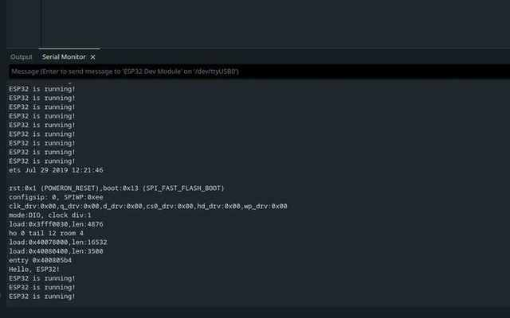

# Hello, ESP32! — serial bring-up

**Status:** Built and verified  
**Difficulty:** Beginner  
**Board:** Espressif ESP32-DevKitC-32UE with ESP32-WROOM-32UE module  
**Build verified:** 31 October 2026

## 1. Goal

Upload a minimal Arduino C++ sketch to the ESP32 and confirm that the chip repeatedly writes text to the computer over its USB-to-UART serial connection.

This is a bring-up exercise. It proves that the board, cable, serial permissions, Arduino IDE board package and firmware uploader work together. It does not yet read a sensor, join a Wi-Fi network or implement an IoT service.

## 2. What you will learn

- The role of `setup()` and `loop()` in an Arduino sketch.
- How `Serial.begin()` configures the serial baud rate.
- How to compile and upload firmware with Arduino IDE.
- How to read UART output in Serial Monitor.
- How the EN/RESET and BOOT buttons differ.

## 3. Hardware and bill of materials

| Item | Required | Used for this build | Approx. cost (INR) |
|---|---:|---:|---:|
| ESP32-DevKitC-32UE | Yes | Yes | Already owned; purchase price not recorded in this project |
| USB data cable compatible with the board | Yes | Yes | Already owned; purchase price not recorded |
| External 2.4 GHz antenna | No for serial test | Not needed for this project | ₹0 additional |
| Breadboard and jumper wires | No | Not used | ₹0 additional |

No additional purchase was required. The ESP32-DevKitC-32UE variant uses an ESP32-WROOM-32UE module with an external antenna connector; the antenna is not involved in a serial-only test.

## 4. Software and versions recorded

| Software / component | Recorded version or value |
|---|---|
| Arduino IDE | 2.3.10 AppImage |
| Arduino-ESP32 board package | 3.3.12 |
| Upload tool | esptool 5.3.1 (shown in upload log) |
| Selected board profile | ESP32 Dev Module |
| Observed serial port | `/dev/ttyUSB0` (may differ on another machine) |
| Serial baud rate | 115200 |

The exact Fedora release and USB-UART bridge chip were not captured as part of this project evidence.

## 5. Wiring and pin map

No breadboard wiring is needed. Connect the ESP32 development board to the computer using a USB data cable.

| Connection | Details |
|---|---|
| Computer ↔ ESP32 | USB cable through the board's USB connector |
| UART0 TX/RX | Routed through the development board's USB-to-UART interface for programming and Serial Monitor |
| GPIO pins | None used |
| Antenna | Not required for this serial-only exercise |

**Power note:** Power the board from its USB connector for this project. Do not connect external voltage to GPIO pins.

## 6. Code

File: [`src/hello_esp32.ino`](src/hello_esp32.ino)

```cpp
void setup() {
  Serial.begin(115200);
  Serial.println("Hello, ESP32!");
}

void loop() {
  Serial.println("ESP32 is running!");
  delay(1000);
}
```

### Code walkthrough

- `setup()` runs once after reset or power-up.
- `Serial.begin(115200)` starts the serial interface at 115200 bits per second.
- `Serial.println(...)` writes text followed by a newline.
- `loop()` runs repeatedly after `setup()` finishes.
- `delay(1000)` pauses for approximately one second between repeated messages.

## 7. Build and upload steps

1. Install Arduino IDE 2.x.
2. In **File → Preferences**, add the Espressif Arduino-ESP32 Boards Manager URL:
   `https://espressif.github.io/arduino-esp32/package_esp32_index.json`
3. Open Boards Manager, search for `esp32`, and install **esp32 by Espressif Systems**. The verified setup used version `3.3.12`.
4. Open this project's `src/hello_esp32.ino` file.
5. Connect the ESP32 with a known-good USB data cable.
6. Select **ESP32 Dev Module** as the board profile. This was the profile used successfully for this board in the recorded build.
7. Select the serial port belonging to the board. In the recorded Fedora session it was `/dev/ttyUSB0`; do not assume that port name is permanent.
8. Click **Verify** to compile, then **Upload** to flash the board.
9. Open **Tools → Serial Monitor** and set its baud rate to **115200**.
10. Press EN/RESET once if you want to see the startup message again.

## 8. Expected output

At 115200 baud, Serial Monitor should show:

```text
Hello, ESP32!
ESP32 is running!
ESP32 is running!
ESP32 is running!
```

The repeating line appears approximately once per second. A short bootloader diagnostic block may also appear after a reset; that is normal.

## 9. Test and validation record

The build was performed with the board connected to Fedora Linux. The supplied Arduino IDE output showed:

- Board identified by esptool as `ESP32-D0WD-V3`, revision `3.1`.
- Firmware write reached 100%.
- Flash verification reported `Hash of data verified`.
- Upload ended with `Hard resetting via RTS pin...`.
- Serial Monitor displayed `Hello, ESP32!` and repeated `ESP32 is running!` after its baud rate was changed to 115200.

This is a manual hardware validation, not an automated unit test. See [`VALIDATION.md`](VALIDATION.md).

## 10. Troubleshooting

### Serial Monitor shows unreadable characters

The sketch uses 115200 baud. Set Serial Monitor to **115200**, not 9600. Both ends must use the same baud rate.

### Fedora reports permission denied on `/dev/ttyUSB0`

Check the port's group:

```bash
ls -l /dev/ttyUSB0
```

The recorded device belonged to group `dialout`. If your device also shows `dialout`, add your login user to that group and start a fresh login session (or reboot):

```bash
sudo usermod -aG dialout "$USER"
```

If the group shown by `ls -l` is different, use the actual group instead; do not blindly add groups or use `chmod 777`.

### Upload is stuck at `Connecting...`

Check that the correct board and USB port are selected. On boards requiring manual download-mode entry, hold BOOT while the uploader is trying to connect, then release it once connection starts. Most uploads should not need this.

### Which button resets the board?

EN (often labelled EN or RESET) restarts the ESP32. BOOT is used to enter download mode during manual flashing; pressing BOOT alone normally does not create visible Serial Monitor output.

### Port is missing

Try a known-good data cable, a different USB port, and then check `ls -l /dev/ttyUSB*` after reconnecting. A charge-only cable will not provide a serial data connection.

## 11. Extensions

No extensions are included in this completed project. Add an extension only after building and testing it, and document it as a separate project or clearly tested revision.

## Build evidence



Screenshot from the physical ESP32-DevKitC-32UE test. It shows the uploaded sketch running and the serial output at 115200 baud.

## 12. References

- Espressif, [ESP32-DevKitC user guide](https://docs.espressif.com/projects/esp-dev-kits/en/latest/esp32/esp32-devkitc/user_guide.html)
- Espressif, [Arduino-ESP32 Serial API](https://docs.espressif.com/projects/arduino-esp32/en/latest/api/serial.html)
- Espressif, [Arduino-ESP32 getting started](https://docs.espressif.com/projects/arduino-esp32/en/latest/getting_started.html)
- Espressif, [Arduino-ESP32 documentation](https://docs.espressif.com/projects/arduino-esp32/en/latest/)

---

**Documentation rule:** Keep this guide aligned with the code and actual hardware test. If a step, component, price or test changes, update the guide and validation record in the same commit.
